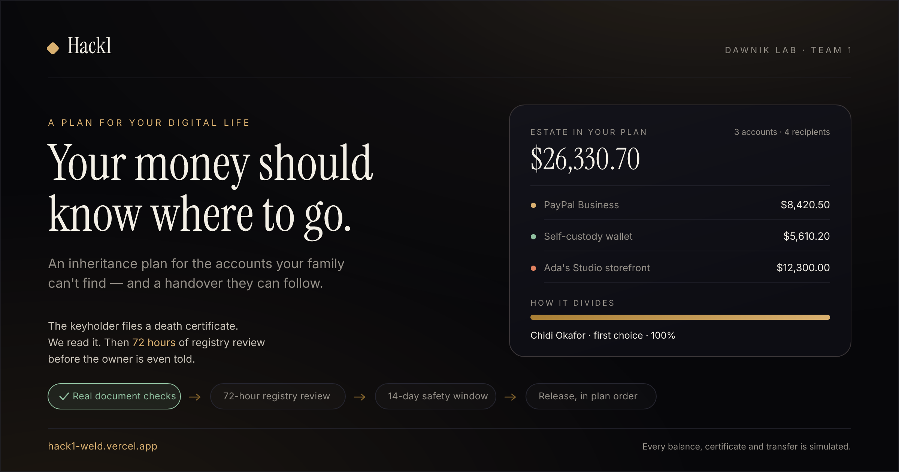

# Hack1 — a plan for your digital life

A working prototype of the **Dormant Billion** idea from *Dawnik Lab Team 1 (PRD)*: a simple,
automated inheritance system for people whose wealth lives in PayPal balances, crypto wallets and
online businesses.

> If something happened to you today, would your family know where your money lives — or how to
> get it?

Hack1 gives someone a way to decide *who gets what, in what order* before it's too late, name a
keyholder who can start the handover, and give the family a plan instead of a puzzle.

**Live demo: <https://hack1-weld.vercel.app>** (no login, seeded with a demo household)



Share cards live in `docs/demo/` (1200×630 for OG/GitHub/X, 1080×1080 for a square post) and are
regenerated with `node scripts/make-demo-image.mjs`.

[](https://vercel.com/new/clone?repository-url=https%3A%2F%2Fgithub.com%2Fdawnikhq%2FHACK1&project-name=hack1&repository-name=hack1)

**All accounts, balances, documents and transfers are simulated.** Nothing here creates a legal
instrument or moves real money.

---

## Run it

```bash
npm install
npm run dev       # http://localhost:3000
```

Requires **Node 22+** (the prototype stores data with the built-in `node:sqlite` module — no native
compilation, no external database).

Production: `npm run build && npm start`.

State is created and seeded automatically on the first request. There is nothing to configure:
locally it persists to `data/hack1.db`; on Vercel it runs in memory (or against Vercel KV if you
attach one — see [Deploy to Vercel](#deploy-to-vercel)).

---

## Deploy to Vercel

The app is ready to deploy as-is — no database to provision, no environment variables required.

**1. Import the repo**

- Go to [vercel.com/new](https://vercel.com/new) → **Import Git Repository** → `dawnikhq/HACK1`.
- Framework preset: **Next.js** (auto-detected). Root directory: `./`. Build command and output
  directory: leave the defaults.
- This work lives on the branch `arena/ecc53be6-hack1`. In the import screen open **"Deploying a
  Git branch"** and pick it — or merge the branch into `main` first and deploy from there.
- Click **Deploy**. Expect ~1 minute.

**2. Optional — make demo state durable**

Without this, the deployment runs in ephemeral mode: data is seeded per serverless instance and can
reset between requests (the demo dock shows a red dot and *"resets per instance"*). For a
stable demo — the one you'll want in front of judges — attach a Redis store:

- Project → **Storage** → **Marketplace** → **Upstash Redis** → *Create* (free tier is plenty) →
  **Connect** to the project.
- Vercel injects `KV_REST_API_URL` + `KV_REST_API_TOKEN` (or the `UPSTASH_REDIS_REST_*` pair) into
  all environments automatically. **Redeploy** once so the functions pick them up.
- The demo dock should now show a green dot and *"Vercel KV / Upstash Redis"*.

The app stores one JSON document under the key `hack1:state`, so nothing else is needed.

**3. Deploy from the CLI (alternative)**

```bash
npm i -g vercel
vercel link                     # link this folder to a Vercel project
vercel deploy                   # preview URL
vercel deploy --prod            # production
```

**Storage resolution order** (`lib/storage/index.ts`):

| Order | Condition | Driver | Durable |
|---|---|---|---|
| 1 | `HACK1_STORE=supabase` \| `kv` \| `sqlite` \| `memory` | forced driver | — |
| 2 | `SUPABASE_URL` + `SUPABASE_SERVICE_KEY` present | Supabase Postgres | ✅ |
| 3 | `KV_REST_API_*` / `UPSTASH_REDIS_REST_*` present | Vercel KV / Upstash | ✅ |
| 4 | local machine with a writable disk | SQLite file | ✅ |
| 5 | anything else (e.g. Vercel with no database) | in-memory, seeded | ❌ |

Remote drivers are wrapped in a guard: if one errors, the app logs it, keeps serving from memory
and reports itself as non-durable in the demo dock instead of returning a 500.

### Why it needed changes for Vercel

Vercel's filesystem is read-only and ephemeral, so the original `node:sqlite` file store would have
thrown `EROFS` on the first write. Persistence is now behind a driver interface with the same
single-document model everywhere, which also made the engine and reset logic simpler.

## The four screens

| Route | Role | What it does |
|---|---|---|
| `/` | — | The story, the mechanics, and a live view of the seeded estate |
| `/onboarding` | Owner | 8-step story-first setup: identity → accounts → primary → backups + split → cause → keyholder → seal |
| `/dashboard` | Owner | Estate breakdown, the handover list, live split preview, keyholder code, safety-window alert, handover trail |
| `/keyholder` | Trusted keyholder | Access code → real certificate upload → automated document checks → 72-hour registry review → notification → 14-day window → release |
| `/beneficiary` | Beneficiary | Read-only: allocation, assets released, the note left for them, and the audit trail |

A floating **Demo** dock (bottom-right) resets the household to its seeded state at any time.

---

## Demo script (90 seconds)

1. **`/`** — the hook, and the seeded estate: $26,330.70 across three accounts, four recipients.
2. **`/dashboard`** — the handover list. Toggle Chidi (primary) to **unreachable** and watch the
   split fall through to the backups at 60/40 instantly. Toggle them all off → everything routes to
   the charity. Toggle back.
3. **`/keyholder`** — *Use demo code*, then *Use the sample certificate*. The document is read for
   real: format, PDF structure, text layer, the deceased's name, the certificate number, the
   registrar and the dates. All twelve checks pass. Now try the second link — *a document that
   isn't one* (a Gumroad payout receipt) — and it is refused with reasons.
4. File the certificate. The claim enters a **72-hour registry check**: the keyholder sees the
   countdown, **the owner sees nothing at all** — back on `/dashboard` the plan is still just
   `Plan active`, and the handover trail has no new entry. Notification is deliberately withheld
   until the check clears.
5. Return to **`/keyholder`** → *Fast-forward the 72 hours*. Now the owner is notified and
   `/dashboard` shows **"Someone started your handover"** with a live 14-day countdown and a cancel
   button. (This is the safety window doing its job.)
6. **`/keyholder`** → *Fast-forward to day 14* → the automation engine releases the estate.
7. **`/beneficiary`** — pick a recipient: their allocation, the assets it came from, and the note
   the owner wrote.
8. Reset from the **Demo** dock and run it again with a different reachability combination.

---

## How it works

```
Next.js App Router (async server components read state directly)
        │
        ├── lib/store.ts        async facade: load → settle → save
        ├── lib/model.ts        the state document, seed, and every mutation
        ├── lib/engine.ts       the allocation rules (pure)
        ├── lib/certs.ts        certificate verification: bytes → verdict, checks, fields
        └── lib/storage/        drivers: supabase.ts · kv.ts · sqlite.ts · memory.ts
```

**Engine rule** (`lib/engine.ts`), executed when a verified claim's safety window ends:

1. Primary beneficiary reachable → receives 100%.
2. Otherwise the reachable backups split the estate by their weights.
3. Otherwise the designated charity receives everything.

Allocation is integer-cent arithmetic with the remainder going to the last recipient, and every
step appends to an immutable `event` trail (the "handover trail" in the UI).

**Certificate verification** (`lib/certs.ts`). The upload is read, not assumed: file signature vs.
extension, size, PDF structure (header + `%%EOF`), text layer, the document's title, the fields a
certificate carries, the deceased's name against the plan owner, the certificate-number format,
date sanity (not future, not stale, issued after death), a known-registry match, PDF producer
tamper signals, and a SHA-256 duplicate check. Twelve checks, three verdicts:

| Verdict | Meaning | What happens |
|---|---|---|
| `verified` | every automated check passed | claim can be filed → 72-hour registry review |
| `needs_review` | soft signals only (a photo, no text layer, unknown registrar) | claim can be filed → 72-hour **human** review |
| `rejected` | a critical check failed | the claim cannot be filed; reasons are shown |

The server re-runs the whole check inside `POST /api/claim`, so a client cannot talk it into
accepting a document. Sample positives/negatives ship in `public/documents/`.

**The 72-hour gate.** A filed claim starts in `review` with `review_ends_at = now + 72h`. The
submission event is recorded as `ownerVisible = 0`, so the owner's snapshot and trail are untouched —
they are not notified. When the check clears, the claim becomes `window`, `verified_at` is stamped,
the owner is notified, `window_ends_at = verified_at + 14 days`, and only then can the engine release
anything. The *fast-forward* buttons walk the demo through one clock per press; a live system waits
for the registrar.

**Safety window.** The owner can cancel at any point in the window (claim → `cancelled`, plan →
`active`, nothing transferred).

**Persistence.** The whole household is one JSON document (`user`, `plan`, `assets`,
`beneficiaries`, `keyholder`, `claims`, `distributions`, `events`). Reads settle any expired window
and write back; mutations are read-modify-write. `POST /api/demo/reset` restores the seed.

### API

| Method | Route | Purpose |
|---|---|---|
| GET | `/api/state` | Full snapshot (auto-settles any expired window) |
| POST | `/api/onboarding` | Create/replace a sealed plan |
| POST | `/api/verify/certificate` | Multipart `file` → verification transcript (verdict, 12 checks, fields, SHA-256). Changes nothing |
| POST | `/api/claim` | Multipart `accessCode` + `file`: re-verifies server-side, then files the claim into the 72-hour check |
| POST | `/api/claim/verify` | Demo: clear the 72-hour check now (production: a registry integration) |
| POST | `/api/claim/cancel` | Owner stops the handover |
| POST | `/api/claim/fast-forward` | Demo: move one clock (72-hour check, then the 14-day window) |
| POST | `/api/beneficiary` | Toggle a beneficiary's reachability |
| POST | `/api/demo/reset` | Restore the seeded household |
| GET | `/api/meta` | Which storage driver is live + a health probe (shown in the demo dock) |

---

## Design notes

- Warm-dark "quiet luxury": ink background, brass accents, Instrument Serif display type, Inter for
  UI — inheritance software that feels like a keepsake rather than a bank form.
- Story-first onboarding (the PRD calls this vital): the first screen explains *why* before asking
  for anything.
- Beneficiary previews are deliberately hidden until a handover completes, so nobody can pressure
  the owner while they're alive.

## Honest limits

- The verifier reads the real file, but it is still a heuristic: it can be fooled by a well-made
  forgery, and it is not connected to any civil registry. That is exactly why a passed document
  still sits in a 72-hour review before the owner is told. It is document processing, not legal
  proof of death.
- Uploaded files are checked in memory and never stored — the claim keeps the SHA-256, the extracted
  fields and the transcript, not the document itself.
- No real platform integration: PayPal, wallets and storefronts would require their own
  cooperation, security controls and compliance work.
- Platform terms and inheritance law still apply. Hack1 makes the process preparable, not
  bypassable.
- The demo is a single shared household: one plan, one keyholder. There are no accounts or logins,
  so anyone with the link can press "Reset demo household".
